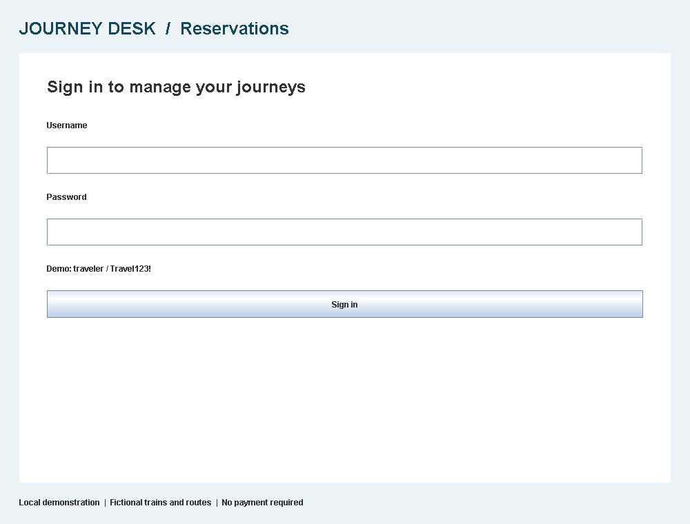
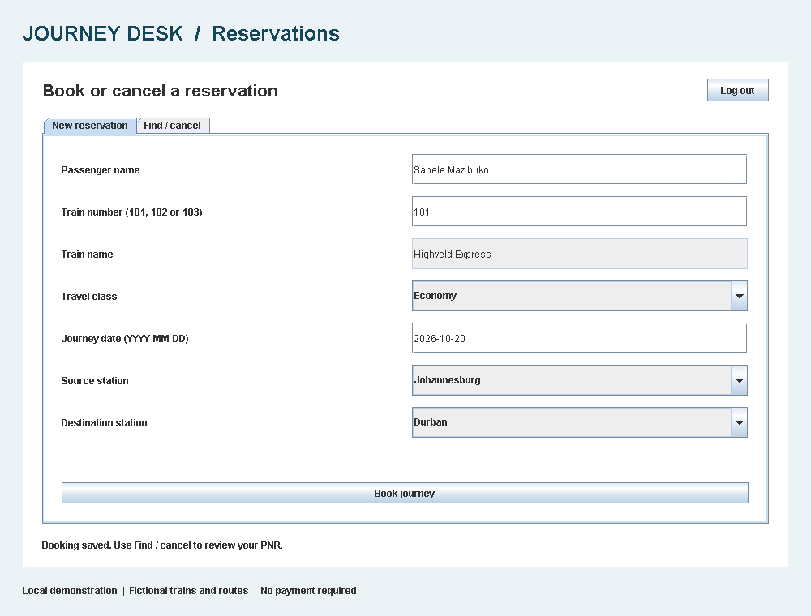
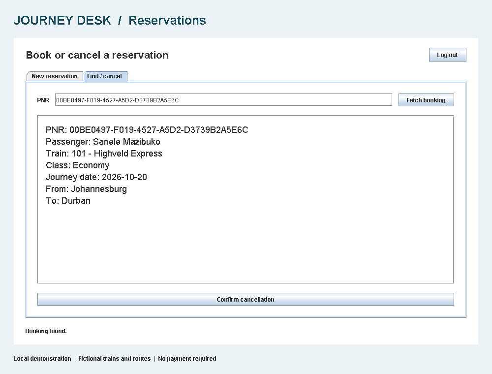
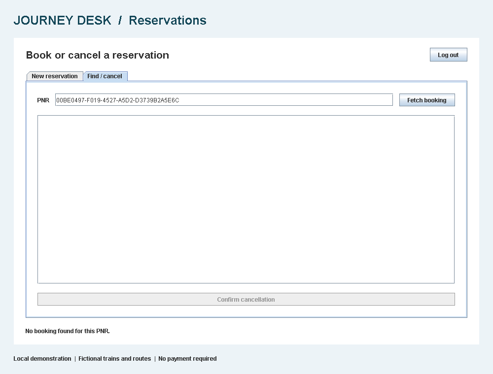

# Online Reservation System

A Java Swing train reservation application with SQLite persistence, for OASIS INFOBYTE Java Development Task 1.

## Run

Requires JDK 17 or later (`java` and `javac` on PATH), Windows PowerShell, and internet access for the first dependency download. Tested with JDK 23; compilation targets Java 17.

Double-click `run.cmd`. It verifies/downloads the pinned JDBC dependencies, compiles the source and opens the application. Later launches work offline when the verified jars are already in `lib/`.

For VS Code, open this project folder, run the setup below in its terminal, then run `src/Main.java`:

```powershell
powershell.exe -NoProfile -ExecutionPolicy Bypass -File .\setup.ps1
```

Demo username: **traveler**

Demo password: **Travel123!**

## Book a journey

1. Sign in with the demo account.
2. Enter a passenger name and a train number from the list below. The train name and available stations fill automatically.
3. Choose Economy, Business or Sleeper; enter a real future date or today's date as `YYYY-MM-DD`.
4. Choose a destination after your source on the train's route.
5. Click **Book journey**. A confirmation dialog displays the saved booking and its unique PNR.
6. Save the PNR. It is also placed in the **Find / cancel** tab for review.

| Number | Train | Stops, in travel order |
| --- | --- | --- |
| 101 | Highveld Express | Johannesburg, Pietermaritzburg, Durban |
| 102 | Coastal Link | Cape Town, George, Gqeberha |
| 103 | Northern Star | Pretoria, Polokwane, Musina |

These are fictional demonstration services, not real schedules or ticket inventory.

## Find or cancel

Open **Find / cancel**, enter a PNR and click **Fetch booking**. The full details are displayed. Click **Confirm cancellation** and choose Yes to delete the reservation. Choosing No keeps it. Editing the PNR clears the previous result and disables cancellation until another booking is fetched.

Bookings are stored in `data/reservations.db` and remain after closing and reopening the app. Lookup and cancellation only access bookings belonging to the signed-in user. Log out before leaving the app open on a shared machine.

## Features

- [x] Login and invalid-credential feedback.
- [x] Passenger, train, class, journey date and station inputs.
- [x] Automatic train-name lookup from the numeric train number.
- [x] JDBC booking insert and unique UUID-based PNR.
- [x] Confirmation dialog with saved details.
- [x] PNR lookup and full booking display.
- [x] Confirmed cancellation and database deletion.
- [x] Required-field, train, date and route validation.

## Design and storage

`DBConnection` creates the schema and opens short-lived SQLite connections. `Passwords` derives salted PBKDF2 password hashes. `Train` provides the demonstration catalogue, and `Booking` represents saved details. `ReservationService` handles authentication, validation and prepared SQL statements. `LoginForm` and `ReservationPanel` provide the Swing interface; `Main` starts it.

The database contains `users` and `bookings` tables with foreign-key enforcement. The demo account is created once and stored as a salted password hash. This learning application has a shared, publicly documented demo login and no registration, payment or seat-allocation system; it is not intended for real passenger data. SQLite files are local and not encrypted.

## Dependencies

`dependencies.json` pins SQLite JDBC 3.53.4.0 and SLF4J API/NOP 1.7.36, with SHA-256 checksums. `setup.ps1` downloads them from Maven Central and verifies their hashes before use. The jars and local database are excluded from Git.

Upstream projects: [SQLite JDBC](https://github.com/xerial/sqlite-jdbc) and [SLF4J](https://www.slf4j.org/). Their respective licenses apply to downloaded libraries.

## Tests

Run from this project folder:

```powershell
.\test.cmd
```

The suite runs 58 checks: 9 database/password checks, 34 service checks and 15 Swing interaction checks. Temporary databases are used and removed after each successful test run. Tests cover persistence across service restarts, invalid input, invalid login, SQL-like input, unique PNRs, account ownership, deletion, cancellation refusal and stale-result prevention.

The Swing tests run headlessly and render actual panels to `screenshots/`. Dialog decisions are injected in tests; native operating-system dialogs are not automated. See `output/test-results.txt` for the verification record.

## Screenshots






## Submission

Record your own walkthrough of login, booking, PNR lookup and cancellation. Demo video: not yet recorded.

Requirements source: supplied OASIS INFOBYTE Task List, Java Task 1 (page 15).
