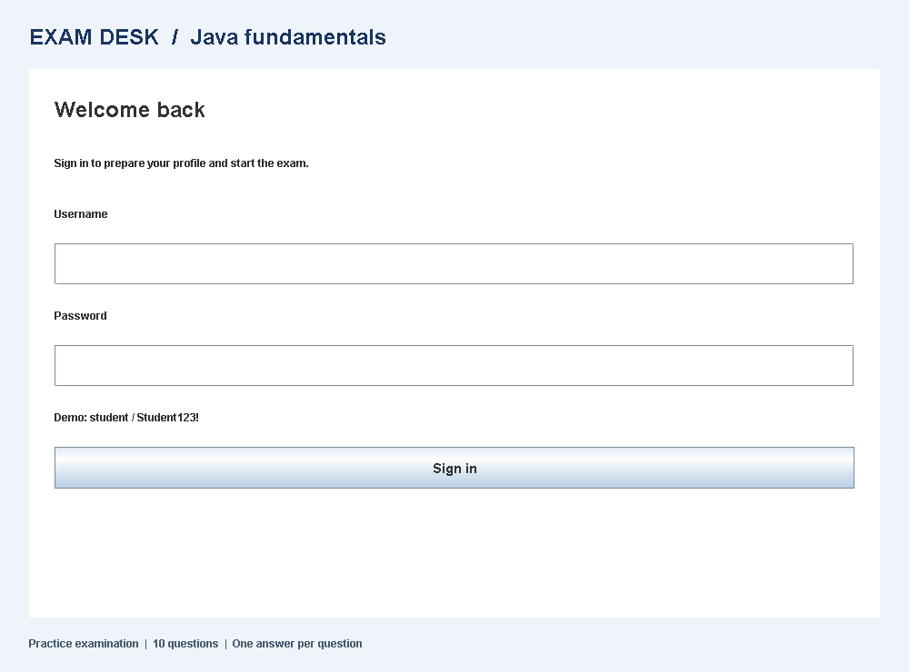
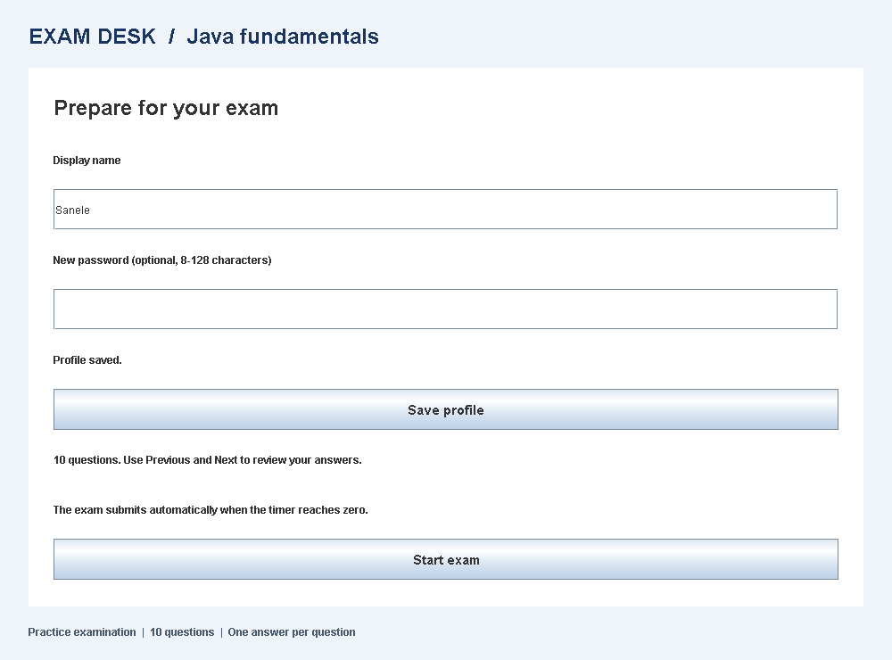
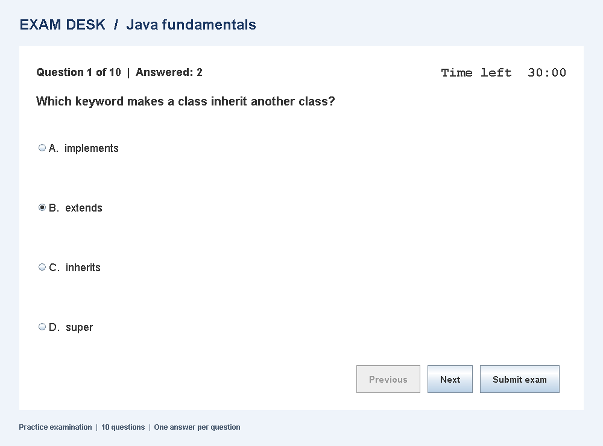
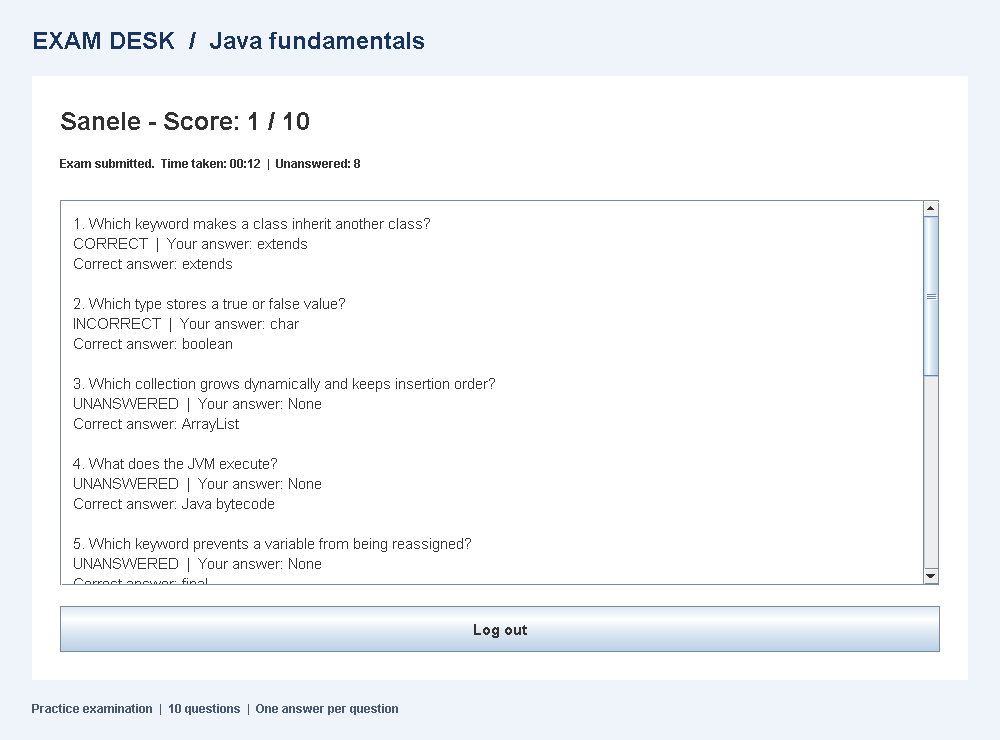

# Online Examination System

A Java Swing practice examination for OASIS INFOBYTE Java Development, Task 4.

## Start

Requires JDK 17 or later with `java` and `javac` on PATH. Tested on JDK 23, with Java 17 source compatibility checked.
Open this project folder in VS Code and run `src/Main.java`, or double-click `run.cmd`.
The application opens in a desktop window. No database, server or external libraries are required.

**Demo username:** `student`
**Demo password:** `Student123!`

## Exam workflow

1. Sign in with the demo credentials. Invalid credentials remain on the login screen.
2. Change your display name or enter an optional new password, then click **Save profile**. Passwords must contain 8-128 characters.
3. Click **Start exam** to begin a 30-minute, ten-question Java fundamentals exam.
4. Choose one of four options. Previous and Next preserve your selections; the header tracks answered questions.
5. Click **Submit exam** and confirm, or wait for automatic submission when time expires.
6. Review your score, elapsed time and each correct, incorrect or unanswered question.
7. Click **Log out** to return to login. Use the changed password if you updated it.

Closing the window during an active exam requires confirmation. Cancelling keeps the exam running. Confirming exits without saving an attempt.

## Features

- [x] Username/password login with invalid-credential feedback.
- [x] Display-name and password updates before starting.
- [x] One question at a time, with four radio-button options.
- [x] Previous/Next navigation and preserved answers.
- [x] Visible countdown and automatic submission at zero.
- [x] Manual submission with confirmation and unanswered-question count.
- [x] Score, time taken and per-question answer review.
- [x] Confirmation before closing during an exam.
- [x] Logout back to login.

## Implementation

- `Question` and `QuestionBank`: immutable question data and ten Java questions.
- `ExamSession`: selected answers, scoring, submission and elapsed-time rules.
- `UserAccount`: demo authentication and validated profile updates.
- `ExamPanel`: Swing cards for login, profile, examination and results.
- `Main`: starts the application on the Swing event thread and handles window closing.

The Swing timer refreshes every 250 ms. Time remaining comes from a monotonic clock, not the number of timer ticks, so delayed UI callbacks do not extend the exam. Submission is idempotent; answers cannot change once time expires or the attempt is submitted. A confirmation dialog does not pause the timer.

This is a local learning project with one demo account. Profile changes and results stay in memory and reset when the application restarts. It does not provide online hosting, persistent accounts or production authentication. Use fictional credentials.

## Verification

From PowerShell in this folder:

```powershell
.\test.cmd
```

The script compiles the project and runs 55 checks: 24 examination-model checks, 13 account/profile checks and 18 Swing interaction checks. UI tests run headlessly on the Swing event thread and regenerate the screenshots. They cover login, profile saving, navigation, manual submission/cancellation, logout, timeout and timeout during a confirmation dialog. Clock injection tests deadlines without waiting 30 minutes.

See [test results](output/test-results.txt).

## Screenshots






The images are rendered from the actual Swing panels using the UI test scenario.

## Submission

Record your own walkthrough of login, profile editing, answering questions, submission, result review and logout.
Demo video: not yet recorded.

Requirements source: supplied OASIS INFOBYTE Task List, Java Task 4 (page 17).
