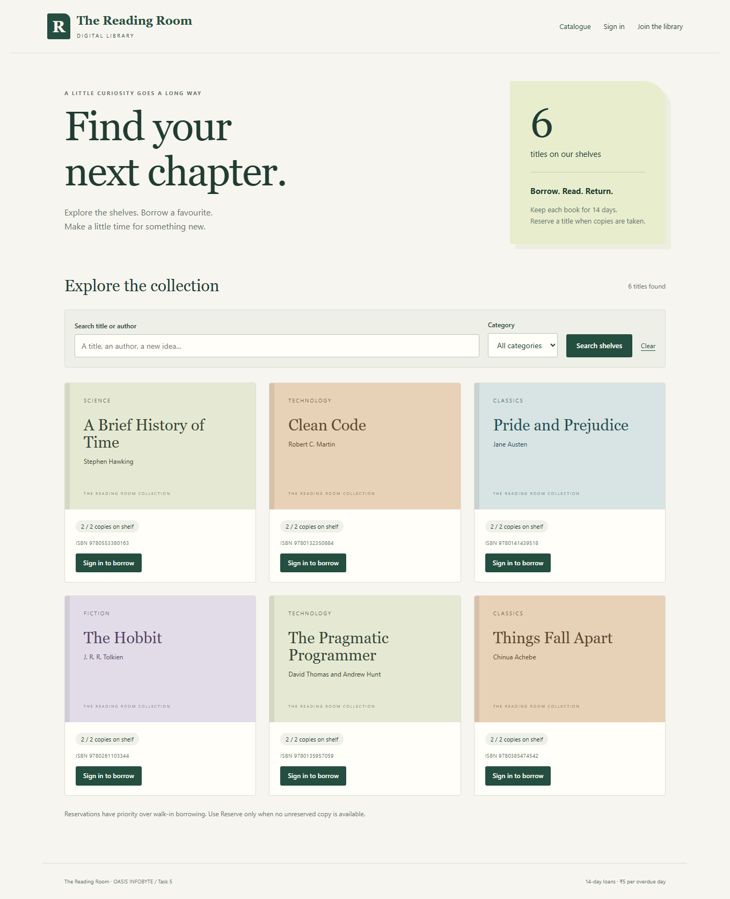
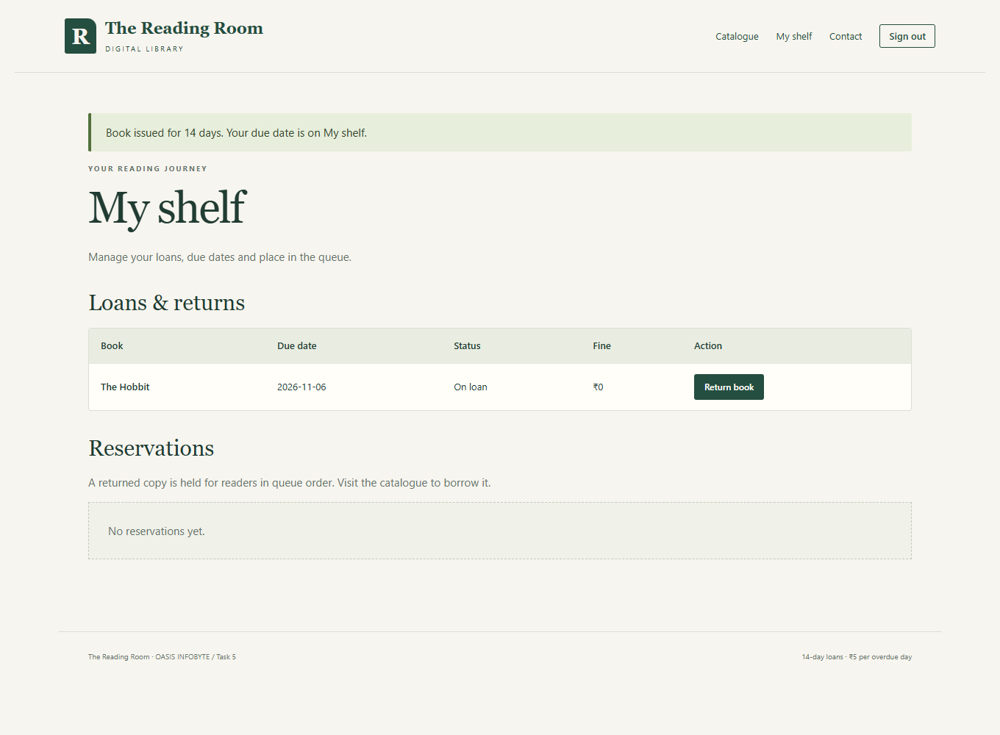
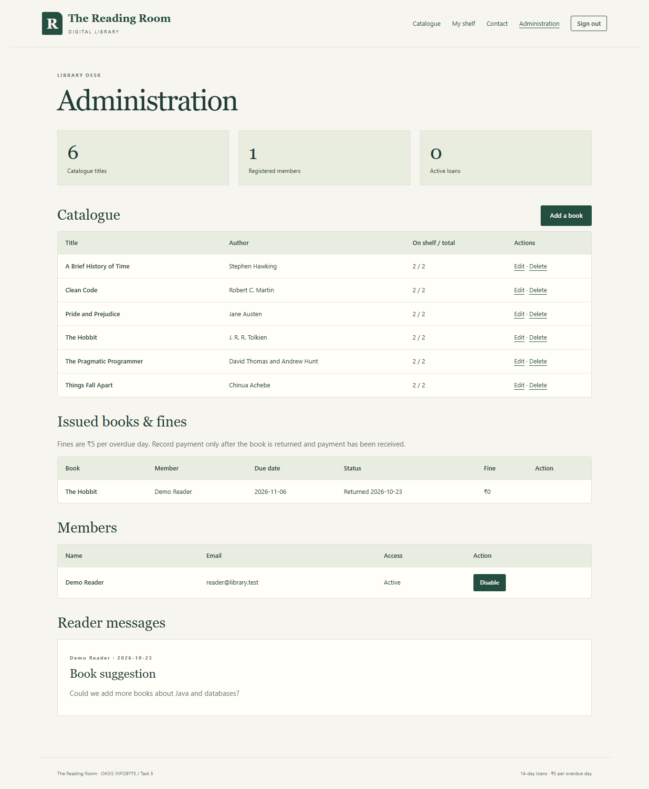

# Digital Library Management System

OASIS INFOBYTE · Java Development · Task 5

**The Reading Room** is a local Java Servlet application for browsing, borrowing and managing library books. It uses embedded Apache Tomcat, SQLite and responsive HTML/CSS. No separate database server or Maven installation is needed.

## Run on your PC

1. Install JDK 17 or newer, with `java` and `javac` on PATH. This project was tested using JDK 23 with Java 17 compilation compatibility.
2. Open this project folder in VS Code: `Java-Task5-DigitalLibraryManagementSystem`.
3. In the terminal, run `./run.cmd` (or double-click `run.cmd` in File Explorer).
4. Wait for the ready message, then open **http://127.0.0.1:8080** in your browser.
5. Keep the terminal running. Press **Ctrl+C** to stop the server.

The first build downloads pinned JARs from Maven Central and verifies their SHA-256 checksums. Later builds reuse verified copies. An internet connection is needed for that first download. The application heap is capped at **192 MB**; this does not include the browser, editor or JVM native memory.

For VS Code debugging, install the Java Extension Pack and press **F5 → Run Digital Library**. The configured build task downloads dependencies and compiles first. Open this individual project folder when debugging to avoid the other projects' `Main` classes.

### Demo accounts

| Role | Email | Password |
| --- | --- | --- |
| Administrator | `admin@library.test` | `Admin123!` |
| Reader | `reader@library.test` | `Reader123!` |

These are public demo credentials for a local learning project. Demo users and six sample titles are inserted only into an empty database. You can also register additional member accounts through **Join the library**.

## Member workflows

- Search books by title or author and filter by category.
- Borrow an available copy for **14 days**. Duplicate active loans of the same book are rejected.
- See due dates, returned books and outstanding fines under **My shelf**.
- Return a book once; its copy becomes available again.
- Reserve a book when all unreserved copies are taken. Reservations are ordered by creation ID; earlier readers have priority. A reader can cancel their own reservation.
- Send a subject and message through **Contact**; administrators can read stored messages.
- Sign out to end the session. Idle sessions expire after 30 minutes.

Available quantity is calculated from total copies minus active loans, so returns cannot accidentally increase stock beyond the catalogue quantity. A returned copy may be held for someone ahead in the reservation queue even when the catalogue shows a copy on the shelf. Reservations do not expire automatically; use **My shelf → Cancel reservation** to release a place. There are no email notifications.

## Administrator workflows

Open **Administration** after signing in as the administrator.

- Add or edit title, author, ISBN, category and quantity. ISBN-10/13 check digits and duplicate ISBNs are validated.
- Delete a book after all copies are returned. Its historical loans remain in the database, while the catalogue entry is archived and pending reservations are removed.
- Review all loans, due dates, returns and fines.
- Enable or disable member access. Active loans or unpaid return fines must be resolved before disabling a member. Disabling also removes their queued reservations and invalidates access from existing sessions on their next request.
- Mark a fine paid after the book has been returned and payment received. This records an administrative acknowledgement; it does not process a bank payment.
- Read messages submitted by members.

Fines follow the document's example: **₹5 per overdue calendar day**. There is no charge on the due date. A book due on January 15 and returned on January 18 has a ₹15 fine. The amount stops growing on the return date and remains visible after payment.

## Data and design

The application creates `data/library.db`. Stop the server before copying the database for a backup. Local data, build outputs and downloaded dependencies are excluded from Git. Run only one application instance against a database; SQLite writes and the service's synchronized lending operations are intended for this local deployment.

| File | Responsibility |
| --- | --- |
| `Database.java` | Schema, foreign keys, indexes and short-lived JDBC connections |
| `Passwords.java` | Salted PBKDF2-HMAC-SHA256 password hashes |
| `Library.java` | Authorization, catalogue, loans, reservation queue, fines and messages |
| `LibraryServlet.java` | HTML pages, session handling, form processing and escaping |
| `Main.java` | Embedded Tomcat bound to `127.0.0.1` |
| `src/main/webapp/style.css` | Responsive member and admin layouts |

SQL values use prepared statements. Service methods recheck roles and active membership. Mutating routes require POST and a session CSRF token. Sessions are renewed after login and registration, use HttpOnly/SameSite cookies, and never put session IDs in URLs. Rendered user content is HTML-escaped. The server also sends a restrictive Content Security Policy.

This is a local demonstration rather than a hosted production service. It has no password reset, email verification, login rate limiting, TLS endpoint, payment gateway, or distributed concurrency support. Passwords are hashed with an individual salt and 210,000 PBKDF2 iterations. The default loopback binding keeps the server on this PC.

The embedded server follows the [Apache Tomcat programmatic API](https://tomcat.apache.org/tomcat-10.1-doc/api/org/apache/catalina/startup/Tomcat.html). Exact versions, download URLs and checksums are in `dependencies.json`.

## Verification

Run `./test.cmd` in the project directory. Tests create temporary databases and do not change `data/library.db`.

| Suite | Checks | Coverage |
| --- | ---: | --- |
| DatabaseTest | 6 | Foreign keys, quantity constraints and salted password verification |
| LibraryTest | 61 | Registration, role checks, stock, FIFO reservations, fine dates, archive/history, concurrency and persistence |
| WebTest | 27 | Real HTTP requests, authentication, CSRF, forbidden admin actions, escaping, borrow/return, contact and logout |
| **Total** | **94** | **All passed** |

Browser verification additionally covered member borrowing and returning, contact submission, admin add/delete, catalogue search and a 390-pixel mobile viewport without horizontal overflow. Screenshots use a separate demo database. Test evidence is in `output/verification.md`.

Tomcat can print JVM module-access warnings while shutting down tests on newer JDKs. These concern optional leak detection; the test exit code and final check counts determine whether the test run passed.

## Troubleshooting

- **Java is not recognized:** install a JDK and reopen VS Code so its terminal gets the updated PATH.
- **Port 8080 is occupied:** stop the previous library server, or build and run `java -Xmx192m "-Dlibrary.port=8081" -cp "bin;lib/*" Main`, then browse to port 8081.
- **Dependency download fails:** check the connection to Maven Central and rerun `./build.cmd`. Do not bypass checksum failures.
- **The browser cannot connect:** keep `run.cmd` running and wait for the ready message. Use `127.0.0.1`, not a remote address.
- **Out of memory:** close unused browser tabs and applications. The project launcher already limits the Java heap to 192 MB.
- **Database is locked:** stop duplicate application instances. Keep the database local while the server is running; avoid simultaneous OneDrive access from another PC.

## Screenshots

[Mobile catalogue screenshot](screenshots/mobile-catalogue.png)

The supplied task document's recording and submission steps remain for the repository owner to complete.
